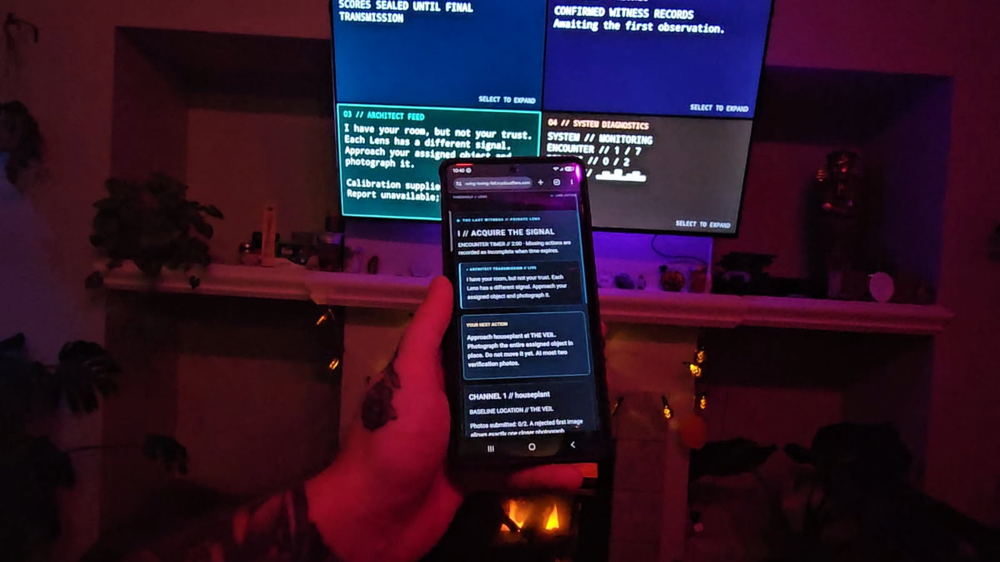
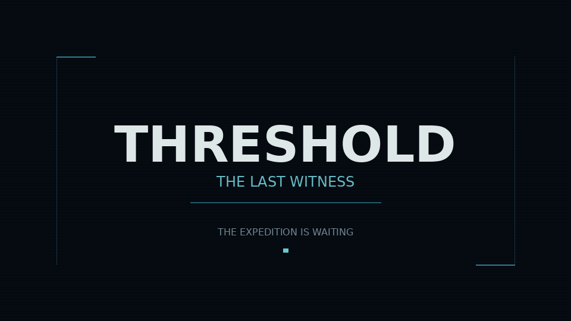
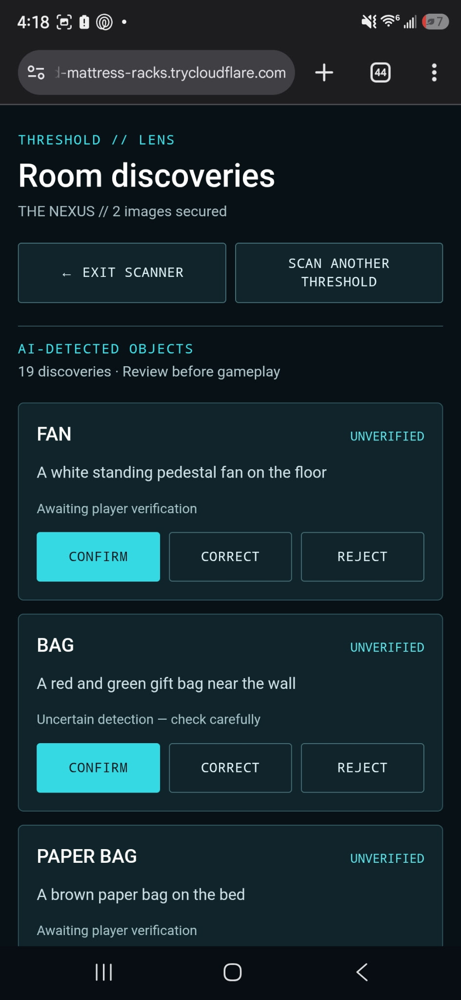
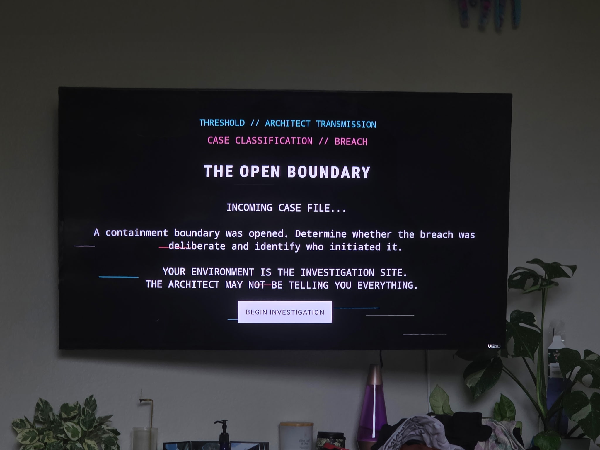
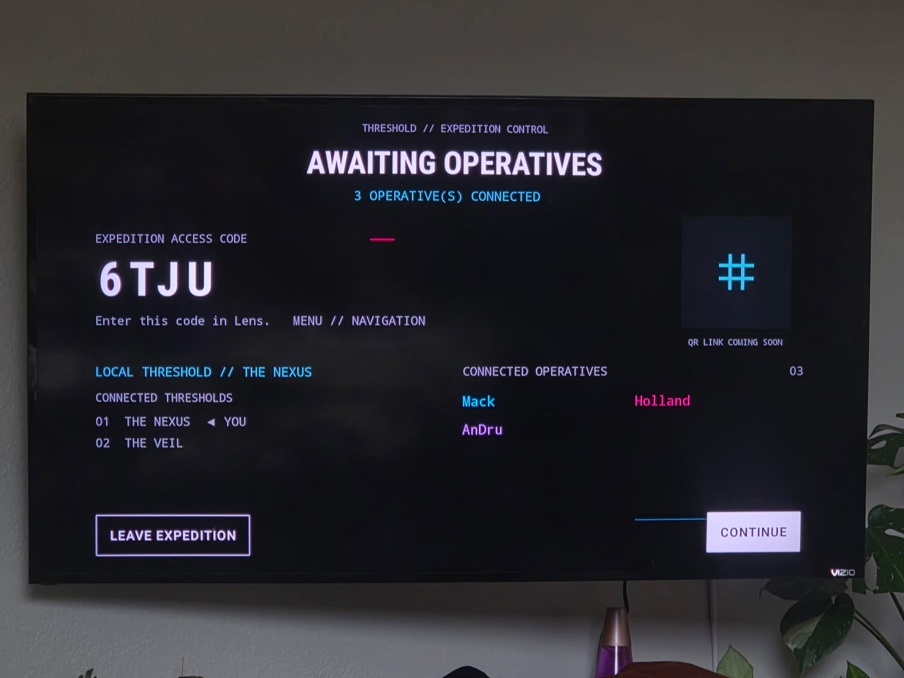
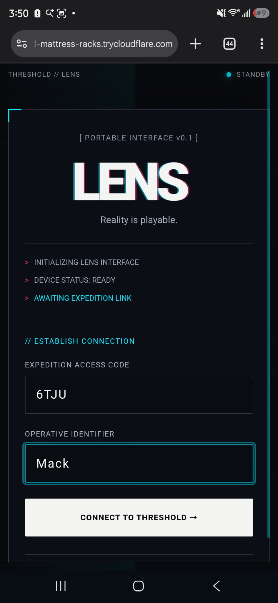
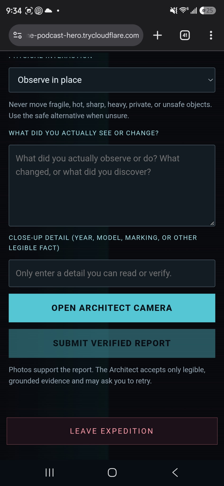
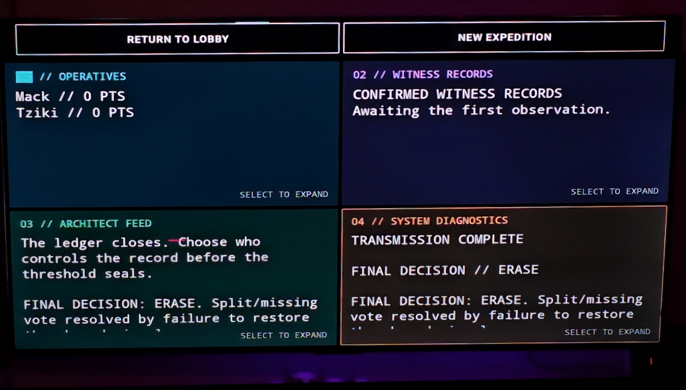
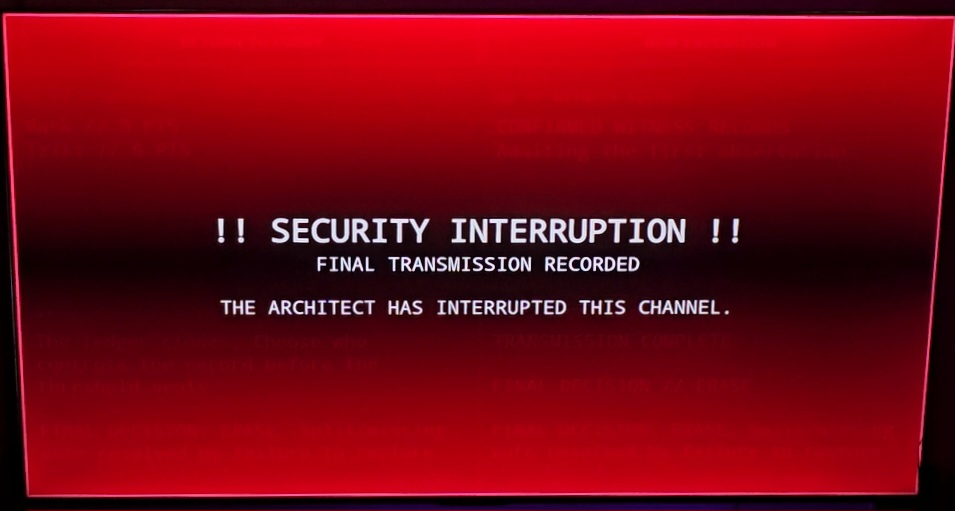

# Threshold

> **Reality is playable.**

**An AI-directed mystery that turns your home into the game world.** Fire TVs become shared terminals called **Thresholds**. Phones become private **Lenses**. An unpredictable entity known as **the Architect** uses the rooms, objects, evidence, and decisions around you to direct an expedition that unfolds across screens *and* the physical environment.

**Featured expedition:** *The Last Witness* · **1–6 players** · **1–4 Fire TVs** · **approximately 8–12 minutes of gameplay** (excluding setup and calibration)

> **Project status — October 22, 2026:** Hackathon prototype with implemented cross-device gameplay, environmental calibration, and a cloud-deployed backend. The experience has been played through in a tested physical-device configuration; **not every player count, Fire OS version, recovery path, or gameplay variation has been validated end to end**.

Hackathon submission: Threshold is being submitted to the Fire TV primary track, with entries in the AWS Builder Mini Challenge and Open Source Mini Challenge.





## Watch the demo

[](https://www.youtube.com/watch?v=UOPRjbpR6G0)

**[▶ Watch Threshold: The Last Witness on YouTube](https://www.youtube.com/watch?v=UOPRjbpR6G0)**

Experience an AI-directed mystery where Fire TVs become shared terminals, smartphones become private Lenses, and your real-world environment becomes part of the game.


**Devpost submission:** _Add the published project link here after submission._

## What makes Threshold different?

- **Your environment is the level.** The Lens captures calibration photos and players confirm objects that can become puzzle anchors. The game must distinguish confirmed evidence from unverified AI guesses.
- **The screens know different things.** Thresholds deliver shared transmissions and terminal interactions; Lenses hold private clues, tasks, evidence, and decisions.
- **The Architect can mislead you.** AI shapes the narration and interprets observations, while a structured backend maintains the authoritative record of game events and permitted actions.
- **People have to leave their seats.** Object inspection, movement, deduction, corroboration, and coordination connect the mystery to the actual room.
- **Solo and multiplayer are intentionally different.** Solo challenges your memory and the Architect's claims; multiplayer introduces cooperation, suspicion, and optional deception when the player count allows.
- **Your decisions matter.** Evidence, accusations, coordination, and a final archive vote shape the recorded outcome.

## See the game

<!-- ===================================================================== -->
<!-- MEDIA TODO 3 — GAMEPLAY SCREENSHOT GALLERY                            -->
<!-- Capture 4–6 genuine screenshots, ideally from the final demo build:  -->
<!-- 1. docs/media/lens-calibration.png — object confirmation/photo flow  -->

<!-- 3. docs/media/lens-private-task.png — private instruction (no token) -->

<!-- 5. docs/media/lens-evidence.png — evidence or confrontation          -->
<!-- 6. docs/media/lens-finale.png — final decision or polished results   -->
<!-- Prefer real captures over mockups. Avoid exposing player identities, -->
<!-- private house details, IPs, session codes, or credentials.            -->
<!-- ===================================================================== -->


## See the game

### Fire TV expedition dashboard


### AI-powered room discovery



The Architect analyzes environmental photographs and identifies objects that players can verify before gameplay.

### The Architect's transmission



An AI-directed mystery unfolds on Fire TV, transforming the physical environment into an investigation site.

### Multiplayer across Fire TVs



Multiple Fire TV devices share an expedition while players join through their personal mobile Lenses.

### Connect your Lens



Players enter an expedition access code and establish their individual connection to the shared experience.

### Investigate the real world



Players interact with their surroundings, document observations, and submit grounded evidence to advance the investigation.




The shared Threshold interface gives players access to expedition information, witness records, the Architect's transmissions, and system diagnostics. Each panel can be expanded for a closer look.

This particular photo is of the final screen. All prior game play screens (after the story introduction) follow this layout.

### The Architect interrupts



The Architect can interrupt the shared display with dramatic transmissions, turning the Fire TV into an active part of the unfolding mystery.


## How *The Last Witness* plays

1. **Connect:** Start an expedition on Fire TV, join on phones with the session code, and optionally register additional TVs.
2. **Calibrate:** Photograph parts of the environment. AI-assisted interpretation and player confirmation identify potential game objects.
3. **Investigate:** Receive private assignments and public broadcasts; inspect objects and establish evidence.
4. **Collaborate or deceive:** Depending on the player count and available objects, relocate and recover evidence, compare fragments, synchronize TV inputs, or accept a private offer.
5. **Confront:** Challenge the Architect's account, corroborate evidence, and decide whom to trust.
6. **Choose:** Vote to **preserve**, **release**, or **erase** the fictional archive and receive an ending. *Erase* is a narrative decision, **not** a promise to delete stored photos.

**Design target:** 8–12 minutes of active gameplay. Calibration, connection, and device setup take additional time. Gameplay paths depend on available devices, player count, confirmed objects, and supported interactions.

### Gameplay flow

.png)

[Gameplay design and stage details](docs/game-design.md) · [Editable gameplay flow diagram](docs/diagrams/threshold-gameplay-flow.mmd)

## How it works

| Component | Role | Technology |
|---|---|---|
| **Threshold** | Shared transmissions, terminal actions, zone-specific display | Native Android / Kotlin on Fire TV |
| **Lens** | Phone-based calibration, private tasks, evidence, choices | React / TypeScript / Vite |
| **Session service** | Authoritative membership, phases, game rules, persistence, APIs | Node.js / Express / TypeScript / SQLite |
| **The Architect** | AI-assisted environmental interpretation and narrative direction | Gemini (cloud) or Ollama (local), behind a provider abstraction |
| **Cloud infrastructure** | Hosted backend, private image storage, configuration, operational logs | AWS EC2, S3, IAM, Systems Manager, CloudWatch; Caddy HTTPS |

**Important:** Amazon Bedrock was evaluated but inference was blocked by account-level quota/access restrictions in the tested account. **Bedrock is not a working runtime provider in this build.** The AWS deployment remains useful for compute, storage, identity, and monitoring.

The Lens and backend are **separate services**: a working backend URL does not automatically provide a publicly hosted Lens website. The project uses HTTP-based client/server coordination and polling; do not assume a WebSocket-based real-time architecture.

### Architecture diagram

.png)

[Full system architecture](docs/architecture.md) · [Editable AWS diagram](docs/diagrams/threshold-aws-architecture.mmd) · [Session lifecycle](docs/session-lifecycle.md)

## Quick start: interactive demo (recommended)

Run a local, multi-device expedition with an HTTPS phone Lens using the demo wizard. This is the recommended way to try **The Last Witness** on physical Fire TV hardware.

**Prerequisites:** Node.js 22+, pnpm 10.18.0, Java 21, Android SDK/ADB for TV deployment, and [`cloudflared`](https://developers.cloudflare.com/cloudflare-one/connections/connect-networks/downloads/) for an HTTPS phone URL. Enable ADB debugging on each Fire TV. For AI-assisted play, run Ollama locally or configure a Gemini API key.

```bash
git clone https://github.com/hmw55/threshold.git
cd threshold
corepack enable
pnpm install --frozen-lockfile
pnpm dev:demo
```

The wizard can register named Fire TVs in the Git-ignored `scripts/fire-tv-devices.local.json`, select which TVs to deploy to, choose an AI provider, set a backend address reachable by the TVs, reuse healthy local services, build/install the APK on selected TVs, and optionally launch a **temporary Cloudflare Quick Tunnel**. When ready, it prints the HTTPS Lens URL: open that URL on each phone, create an expedition on a TV, and join with the TV's code. Phone camera access requires a secure origin (HTTPS).

```bash
pnpm fire-tv:demo  
# This script does not start a fresh instance after game play. Either wait for the times to run out to restart or kill other instances.
```

**How the URLs work:** the phone opens `https://<generated>.trycloudflare.com`; Lens uses `VITE_SESSION_SERVICE_URL=/` and Vite proxies `/sessions` to the local backend on port 3001. TVs use a separate backend address reachable from their network, such as `http://YOUR_LAN_IP:3001`. The TV address must reach **the same session service** as the Lens. WSL2 NAT may require Windows port forwarding/firewall configuration. The Cloudflare URL changes between runs; don't save an old tunnel URL as the Lens API base.

**If the phone says “Failed to fetch”:** check that `apps/lens/.env.local` contains `VITE_SESSION_SERVICE_URL=/` and that no higher-priority `apps/lens/.env.development.local` overrides it with an expired tunnel URL. Restart Vite after correcting the configuration. You can verify the actual served value with:

```bash
curl -s http://127.0.0.1:5173/src/services/apiClient.ts \
  | grep -o '"VITE_SESSION_SERVICE_URL": *"[^"]*"'
# Expected: "VITE_SESSION_SERVICE_URL": "/"
```

For detailed setup, manual three-terminal development, troubleshooting, and security notes, see the [development environment guide](dev-notes/development-environment.md).

### Manual contributor workflow

For debugging individual services, you can still run `pnpm dev:resume` for the backend, `pnpm --filter lens dev --host 0.0.0.0` for Lens, and `./gradlew assembleDebug` under `apps/fire-tv` for the APK. Unlike `dev:demo`, this workflow requires you to configure network addresses and HTTPS yourself. `pnpm dev:resume` preserves local SQLite sessions; **`pnpm dev:fresh` deletes the designated local expedition database**.

```bash
pnpm check                       # lint + typecheck + tests
pnpm build                       # workspace build
pnpm dev:demo                    # interactive local demo + optional HTTPS tunnel
pnpm fire-tv:demo                # deploy selected TVs without launching services
pnpm fire-tv:dev                 # legacy named-device selector
pnpm fire-tv:deploy:all          # installs to ALL authorized ADB devices
pnpm fire-tv:launch:all          # launches on ALL authorized ADB devices
```

## Documentation and repository map

```text
threshold/
├── apps/
│   ├── README.md                 # How the two client applications fit together
│   ├── lens/README.md            # Mobile Lens setup and development
│   └── fire-tv/README.md         # Android/Fire TV build, ADB and device setup
├── services/session/README.md   # Session service, API, auth, AI and storage
├── scripts/README.md            # Custom CLI scripts and device aliases
├── docs/
│   ├── architecture.md           # System design and trust boundaries
│   ├── game-design.md            # The Last Witness gameplay and mechanics
│   ├── session-lifecycle.md      # Session and expedition state transitions
│   ├── diagrams/                 # Architecture and gameplay diagrams
│   └── friction-logs/            # Amazon and general engineering feedback
├── dev-notes/
│   ├── development-environment.md # Contributor runbook
│   └── decisions.md              # Technical decision records
└── package.json
```

**Start here:** [Complete contributor setup](dev-notes/development-environment.md) · [Backend API](services/session/README.md) · [Scripts reference](scripts/README.md) · [Fire TV guide](apps/fire-tv/README.md) · [Lens guide](apps/lens/README.md)

**Understand the project:** [Game design](docs/game-design.md) · [Architecture](docs/architecture.md) · [Session lifecycle](docs/session-lifecycle.md) · [Technical decisions](dev-notes/decisions.md)

**Development feedback:** [Friction log overview](docs/friction-logs/README.md) · [Amazon developer experience](docs/friction-logs/amazon.md) · [General developer friction](docs/friction-logs/developer.md)

## Testing and limitations

The project has been compiled, tested, and exercised on physical Fire TV hardware, with a complete expedition reported in a tested configuration. Automated tests cover portions of session and game behavior, but the prototype is **not** a guarantee of full coverage for all 1–6-player combinations, 1–4-TV arrangements, network conditions, AI outcomes, or device-reconnection paths.

The experience uses photos of real environments. Only photograph spaces and objects you are authorized to capture; avoid personal documents, sensitive information, and unsafe object-moving tasks. AI descriptions are treated as fallible observations, not verified facts.

For known engineering issues and their resolutions or open status, see the [developer friction logs](docs/friction-logs/README.md).

## Open Source & Contributions

Threshold is an open-source project developed for the **Build, Ship, Shape: Amazon Developer Hackathon**.

The project is released under the **MIT License**, allowing developers to use, study, modify, distribute, and build upon the source code, including for commercial purposes, provided the original copyright and license notices are preserved.

Contributions are welcome, including bug fixes, performance improvements, accessibility enhancements, documentation, gameplay systems, and cross-device compatibility testing.

To get started:

1. Read the [Development Environment & Contributor Guide](dev-notes/development-environment.md).
2. Review the README for the application or service you want to contribute to.
3. Create a branch for your changes.
4. Run the relevant local checks and tests.
5. Open a pull request describing your changes and how they were validated.

Bug reports, feature suggestions, and testing feedback can be submitted through [GitHub Issues](https://github.com/hmw55/threshold/issues).

**License:** [MIT License](LICENSE) — Copyright © 2026 Holland M. Wesley.

---

**Threshold isn't a game you play in a room. The room is part of the game.**