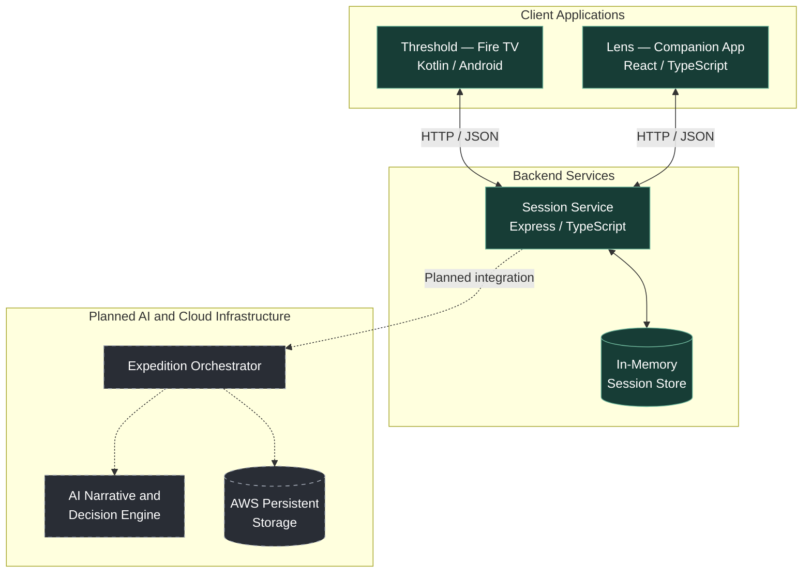
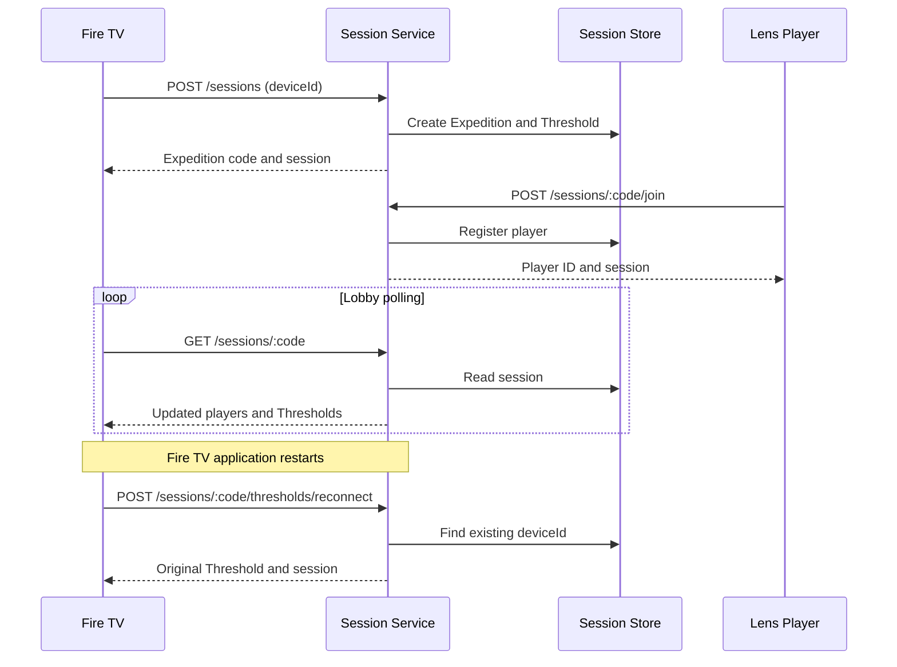
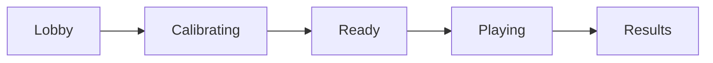

# Threshold — System Architecture

## 1. Overview

Threshold is a multiplayer, AI-driven interactive experience designed around Amazon Fire TV and companion devices.

Each Fire TV acts as a **Threshold**, representing a physical environment within a shared Expedition. Players participate as **Operatives** through the companion application, Lens.

The long-term architecture combines device coordination, shared multiplayer state, environmental input, and AI-driven narrative orchestration.

This document distinguishes implemented components from planned systems.

## 2. High-Level Architecture

Solid connections represent existing application communication. Dashed connections represent planned integration.

The diagram is conceptual and does not imply that AWS resources or AI orchestration have already been deployed.

## 3. Implemented Components

### 3.1 Threshold — Fire TV

**Technology:** Kotlin, Android, Gradle

The Fire TV application provides the primary shared display and represents a registered physical environment.

Current responsibilities include:

- Creating and joining Expeditions.
- Generating and persisting a device identity.
- Registering with the session service.
- Restoring previous Expedition membership after application restart.
- Displaying the Expedition lobby.
- Polling the session service for updated membership.
- Presenting local gameplay phase screens.
- Leaving an Expedition.

Each registered Fire TV receives a unique Threshold ID and an assigned zone.

The current application uses HTTP requests for session operations and periodic polling for lobby updates.

**Limitation:** Gameplay phase progression currently occurs locally rather than through a server-authoritative state machine.

### 3.2 Lens — Companion Application

**Technology:** React, TypeScript

Lens provides the companion interface for participating players, referred to as Operatives.

The session service exposes operations for:

- Joining an Expedition using a code.
- Receiving a player identity.
- Reconnecting using an existing player ID.
- Leaving an Expedition.
- Reading shared Expedition state.

These backend capabilities are implemented. The exact state of corresponding Lens UI flows and client-side restoration requires separate verification.

### 3.3 Session Service

**Technology:** Node.js, Express, TypeScript

The session service coordinates Expedition membership and shared session metadata.

Current responsibilities:

- Creating Expeditions.
- Generating unique four-character codes.
- Registering up to four Fire TV devices.
- Assigning distinct zones.
- Registering companion players.
- Supporting Fire TV and player reconnection.
- Maintaining Expedition status and phase metadata.
- Handling individual departures.
- Closing Expeditions when the final Fire TV leaves.

The session service exposes an HTTP/JSON API.

### 3.4 Session Storage

**Current implementation:** Process-local JavaScript `Map`.

Each Expedition contains:

| Property | Purpose |
|---|---|
| `code` | Four-character Expedition identifier |
| `players` | Registered Operatives |
| `thresholds` | Registered Fire TV devices |
| `status` | Player-readiness indicator |
| `phase` | Shared Expedition phase field |

This design is sufficient for a single-instance development prototype.

However, sessions are lost when the server process restarts, and state cannot be shared reliably across multiple service instances.

## 4. Identity and Zone Assignment

Each Fire TV generates a UUID on first use and persists it in Android `SharedPreferences`.

That identifier is sent to the backend when creating, joining, or reconnecting to an Expedition.

The backend assigns one of four zones:

| Assignment order | Zone |
|---|---|
| 1 | THE NEXUS |
| 2 | THE VEIL |
| 3 | THE RELIQUARY |
| 4 | THE OBSERVATORY |

When a registered Fire TV reconnects, the service returns the original Threshold record.

This preserves its Threshold ID, assigned zone, and join timestamp.

If a device leaves and subsequently joins again, it is treated as a new registration and receives an available zone.

## 5. Session Communication

The current session architecture uses HTTP requests and JSON responses.

This sequence illustrates the existing backend API and Fire TV communication. Lens request sequencing should be validated against its current implementation.

## 6. Expedition Lifecycle

The backend defines five Expedition phases:

**Important:** This diagram represents the intended progression, not a fully implemented server-authoritative workflow.

The Fire TV currently implements local transitions between these states.

The backend stores a `phase` property but the inspected session routes do not provide synchronized phase-transition operations.

A future orchestration layer will need to define authoritative transitions and communicate them to all participating clients.

## 7. Planned AI Orchestration

The planned Expedition Orchestrator will coordinate the experience beyond session membership.

Potential responsibilities include:

- Tracking authoritative gameplay state.
- Receiving player actions and environmental observations.
- Requesting AI-generated narrative or gameplay decisions.
- Applying gameplay rules and validation.
- Distributing outcomes to Fire TV and Lens clients.
- Managing transitions between Expedition phases.

The AI layer is intended to support adaptive experiences rather than replace deterministic game rules.

**Design principle:** AI output should be validated by application logic before changing shared gameplay state.

The exact AI provider, model integration, event schema, and orchestration deployment have not yet been established in the verified architecture.

## 8. Planned AWS Infrastructure

AWS is the intended cloud platform for the project's hackathon deployment.

Possible future infrastructure responsibilities include:

- Hosting backend services.
- Persisting Expedition and gameplay state.
- Managing application configuration and secrets.
- Providing operational logging and monitoring.
- Supporting AI orchestration.
- Enforcing access controls and resource limits.

Specific AWS services should be documented once selected and implemented.

This section does not represent an existing production deployment.

## 9. Reliability and Security Considerations

### Current strengths

- Persistent Fire TV device identity.
- Idempotent registration for an already-connected TV.
- Dedicated reconnection endpoints.
- Stable zone assignment during reconnection.
- Explicit removal of departed devices.
- Backend regression tests covering core session operations.
- Android generation tracking to prevent stale asynchronous responses from updating the UI.

### Current limitations

- In-memory session storage.
- No implemented automatic session expiration.
- No authenticated device or player identity.
- Permissive backend CORS configuration.
- Polling rather than server-pushed state updates.
- No server-authoritative gameplay phase transitions.
- No durable recovery after session-service restarts.
- No verified end-to-end Fire TV restart test.

These limitations should be addressed according to gameplay requirements and deployment constraints rather than through unnecessary early infrastructure complexity.

## 10. Testing and Validation

Current verified results:

| Component | Validation | Result |
|---|---|---|
| Session service | Vitest test suite | 25 tests passed |
| Session service | Test files | 5 passed |
| Fire TV | `:app:assembleDebug` | Build successful |
| Fire TV reconnection | Compilation | Successful |
| Fire TV reconnection | Device restart and recovery | Pending |
| Lens | End-to-end reconnection | Pending |
| AI orchestration | Integration testing | Not implemented |

The backend tests include reconnection behavior and preservation of existing Threshold assignments.

Compilation verifies the Android implementation builds, but does not establish runtime behavior on physical Fire TV hardware.

## 11. Architecture Roadmap

### Foundation

- [x] Implement Expedition creation and membership.
- [x] Implement persistent Fire TV identity.
- [x] Implement backend reconnection.
- [x] Add Fire TV startup restoration logic.
- [x] Add backend session regression tests.
- [ ] Verify reconnection on a running Fire TV.
- [ ] Verify Lens client restoration behavior.

### Multiplayer Coordination

- [ ] Define shared gameplay event contracts.
- [ ] Implement authoritative phase transitions.
- [ ] Synchronize gameplay state across clients.
- [ ] Define Expedition completion and cleanup semantics.

### AI Integration

- [ ] Define AI orchestration responsibilities.
- [ ] Implement structured AI input/output contracts.
- [ ] Validate AI decisions