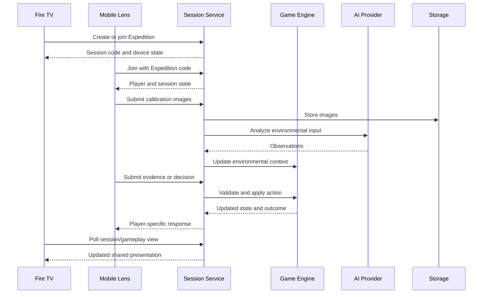

# Threshold — System Architecture

> **Reality is playable.**

## 1. Overview

Threshold is an AI-directed, environment-aware adventure built around **Fire TV Thresholds**, **mobile Lenses**, and a shared **Expedition service**. In **The Last Witness**, players investigate a mystery using their actual rooms and objects while an AI character, **The Architect**, directs the experience. The server coordinates players, devices, evidence, decisions, and game outcomes.

The hackathon build targets **1–4 Fire TV devices**, **1–6 Lens players**, and an approximately **8–12-minute** playable expedition. The architecture supports both solo and multiplayer modes; particular interactions and outcomes depend on player count and the current game state.

This document describes the implementation represented in the October 22, 2026 `main` source snapshot, alongside the separately reported AWS deployment. **A component existing in source code does not, by itself, establish successful end-to-end deployment or runtime testing.**

## 2. Architecture diagrams

The repository contains source-controlled Mermaid diagrams alongside the exported Lucidchart images. The images preserve the presentation-oriented visual layouts; the Mermaid files provide maintainable, text-based alternatives.

| View | Mermaid source | Exported image |
|---|---|---|
| Game systems architecture | [Mermaid](diagrams/threshold-game-architecture.mmd) | — |
| Gameplay flow | [Mermaid](diagrams/threshold-gameplay-flow.mmd) | [PNG](diagrams/Threshold-Gameplay-Flow(3).png) |
| AWS deployment architecture | [Mermaid](diagrams/threshold-aws-architecture.mmd) | [PNG](diagrams/Threshold-AWS-Architecture(1).png) |

The Mermaid sources can be opened in [Mermaid Live](https://mermaid.live/) or embedded in GitHub Markdown using a `mermaid` code fence. The gameplay flow documents the player journey; the game systems diagram explains application responsibilities; the AWS diagram documents infrastructure. These views are complementary rather than interchangeable.

## 3. Component responsibilities

| Component | Implementation | Responsibility |
|---|---|---|
| **Threshold** | `apps/fire-tv` — Kotlin / Android / Jetpack Compose | Shared television interface, session participation, Architect transmissions, and TV-side gameplay |
| **Lens** | `apps/lens` — React / TypeScript / Vite | Player identity, joining, calibration photography, field evidence, private information, and choices |
| **Session service** | `services/session` — Node.js / Express / TypeScript | HTTP endpoints, device and player coordination, game requests, and shared state |
| **Game systems** | `services/session/src/game` | Expedition lifecycle, environmental cases, field investigation, evidence, decisions, and Last Witness outcomes |
| **Architect / AI** | `services/session/src/architect` | Structured prompts, narrative responses, environmental interpretation, and provider integration |
| **Persistence and images** | Server-side storage modules; SQLite and configurable image storage | State persistence and calibration image handling |

### 3.1 Fire TV Thresholds

A Fire TV serves as a shared terminal for an Expedition. Devices create or join sessions, display lobby and gameplay information, and communicate with the backend through HTTP. Device registration and reconnection are designed to preserve device identity across app restarts. A multi-TV Expedition shares session context while each screen can present its own relevant information.

**Transport:** HTTP/JSON with polling; do not describe the current implementation as WebSocket-based or server-push real-time messaging.

### 3.2 Mobile Lenses

Each Lens is a browser-based player interface. Lenses join by Expedition code, contribute room photographs during calibration, inspect environmental evidence, and receive or submit player-specific interactions. Lens gameplay is not merely a remote control for the television: physical movement, observation, and choices are part of the game loop.

### 3.3 Session service and authoritative state

The Express service exposes session, calibration, field-expedition, and witness-related routes. Its role is to accept requests from both client types, validate actions, and coordinate the state used to generate subsequent views and outcomes. The repository includes dedicated field and witness gameplay modules, rather than relying on an AI model to maintain the entire mystery in free-form text.

Session membership, device coordination, gameplay progression, and persistence should be understood as related but distinct concerns. **Do not assume every UI transition is perfectly synchronized across devices solely because the backend has a shared state model.**

### 3.4 The Last Witness game systems

The game implementation includes environmental-case logic, field expedition mechanics, witness-related expedition logic, and API routes for evidence and gameplay actions. A structured engine provides a source of game state and constraints; the Architect adds adaptive narration and interpretation. This separation is important for continuity, repeatability, and preventing an AI response from independently rewriting authoritative facts.

Gameplay is intended to combine investigation, cooperation, competition, and consequential choices. Exact branches and interactions should be validated through device playthroughs rather than inferred from module names.

## 4. Environmental calibration and evidence flow

1. Players use a Lens to capture calibration images of their environment.

2. The Lens submits the images to the backend, which uses its configured image-storage path.

3. The environmental analysis integration processes relevant images and returns observations.

4. The game systems use supported observations to establish environmental context for the expedition.

5. Players subsequently interact with physical objects and submit evidence or decisions through their Lenses.

6. The service evaluates actions and returns updated gameplay state or narrative instructions to the participating clients.

**Evidence integrity:** A generated narrative must not be presented as independent proof that a specific object was visible in a photo. Environmental observations and the game's canonical facts must remain distinguishable from the Architect's in-character claims.

## 5. AI architecture

The code exposes a provider abstraction through `services/session/src/architect/createAiProvider.ts`:

- **Google Gemini** — supported cloud provider, used for current cloud-backed AI workflows.

- **Ollama** — supported local-development provider.

- **Amazon Bedrock** — **not implemented as an inference provider** in the inspected source. Explicitly selecting `bedrock` raises an error.

The Architect is a gameplay character and narrative director, not the authoritative database. AI-generated material is consumed within application workflows; deterministic gameplay state and rule evaluation remain the responsibility of the backend.

Provider availability, model quotas, network connectivity, and response latency affect runtime behavior. A successful calibration request does not establish that every later AI gameplay path has been tested end to end.

## 6. Storage and AWS deployment

The current project uses SQLite-backed server persistence and a configurable image-storage layer. For the reported AWS deployment, the backend is hosted on **Amazon EC2**, with **Caddy** providing HTTPS ingress. Calibration images use private **Amazon S3** storage; configuration and operations involve **IAM**, **Systems Manager Parameter Store**, and **CloudWatch**. The project has also used a local image-storage mode for development.

The reported backend endpoint is `https://threshold-game.duckdns.org`. **This endpoint is the backend, not a standalone public hosting URL for the Lens frontend.** Lens hosting and judge-access instructions must be documented separately before the submission is treated as independently reproducible.

The AWS diagram contains deployment details; this document intentionally focuses on responsibilities and data flow. Do not infer high availability, autoscaling, or multi-instance coordination from the use of EC2 and SQLite.

## 7. Communication and gameplay lifecycle

This is a **conceptual representative sequence**, not a claim that all requests are made in exactly this order on every playthrough. Calibration, gameplay, and results include alternate branches and player-count-dependent behavior.

## 8. Trust boundaries and failure behavior

### 8.1 Authoritative state versus AI narration

The backend game engine owns canonical session and expedition state, including accepted actions, evidence, and outcomes. Lens and Fire TV clients supply player input and display server responses; neither client should be treated as the authoritative record. Environmental image analysis produces observations that the game can use as context, not unquestionable facts. The Architect may be deceptive *in character*, but its narrative assertions must not be mistaken for verified photographic evidence or permission to overwrite the game's canonical state.

### 8.2 Failure and recovery boundaries

- **AI requests:** provider errors, latency, and quota limits can interrupt image analysis or narration. A complete fallback for every gameplay path has not been verified.
- **Lens disconnection:** session identity and reconnection behavior must be tested against the current build; do not assume that an in-progress action is replayed automatically.
- **Fire TV disconnection:** device registration and reconnection paths exist, but screen restoration and synchronization should be checked on hardware.
- **Service restart:** SQLite provides persistence, but restart recovery for every in-progress expedition state has not been demonstrated by this document.
- **Concurrent actions:** HTTP polling can delay cross-device visibility. Simultaneous choices and conflicting actions require multiplayer validation.

## 9. Reliability, privacy, and security

### Implemented architectural safeguards

- Server-managed sessions and gameplay operations.

- Device registration and reconnection paths.

- Provider abstraction separating AI integration from gameplay rules.

- Private S3 image storage in the reported cloud configuration.

- HTTPS ingress for the reported EC2 backend.

- Cloud configuration and monitoring through AWS services.

- Automated tests for backend gameplay and session behaviors.

### Known boundaries and areas requiring verification

- **Device synchronization:** polling can introduce latency; test simultaneous actions and reconnection on physical devices.

- **Identity and authorization:** a join code and device identifier should not be represented as strong user authentication.

- **Images and privacy:** verify retention, deletion, access policy, consent messaging, and treatment of real household photographs before broader release.

- **AI correctness:** model responses may be delayed, inconsistent, or incorrect; application rules should constrain outcomes.

- **Operational resilience:** verify backend restarts, persistence behavior, service limits, and recovery; a single EC2 instance is not a high-availability architecture.

- **Public access:** hosting the backend does not automatically make the Lens client publicly accessible.

## 10. Testing and verification

The repository contains tests for session behavior, environmental cases, field mechanics, witness routes, and expedition scenarios. The source snapshot also contains native Fire TV and Lens clients. **Test counts and successful builds should be recorded from a fresh run on the documentation branch**, not copied from an older architecture document.

Recommended validation before publishing a final test matrix:

1. Run the session-service test suite and record the exact command, date, and result.

2. Build the Lens frontend.

3. Build and lint the Fire TV application.

4. Perform one complete solo expedition and one multi-device expedition on physical hardware.

5. Verify the deployed AWS backend, calibration image flow, reconnection, and results screen.

6. Check that screenshots, diagrams, and documentation describe the tested build.

## 11. Current scope versus future work

**Current hackathon focus:** a complete, polished **Last Witness** slice with calibration, environmental investigation, responsive Architect interactions, decisions, and an ending.

**Potential future expansion:** additional expeditions, richer environmental integrations, more robust identity and privacy controls, improved lifecycle automation, and broader device support. These are roadmap directions, **not claims of implemented features**.

## 12. Reproducibility and related documentation

Reproduction requires the Fire TV client, Lens frontend, and session service to be configured to communicate with the same backend. The cloud backend URL alone is not a publicly hosted playable Lens application. Review the repository's setup and development-environment instructions for the required runtime configuration, environment variables, device networking, and build steps. Do not publish real API keys, cloud credentials, or household calibration images as part of a reproducible example.

- [Game design](game-design.md)

- [Session lifecycle](session-lifecycle.md)

- [Developer friction logs](friction-logs/README.md)

- [Game systems diagram](diagrams/threshold-game-architecture.mmd)
- [AWS deployment diagram](diagrams/threshold-aws-architecture.mmd)
- [Gameplay flow diagram](diagrams/threshold-gameplay-flow.mmd)
