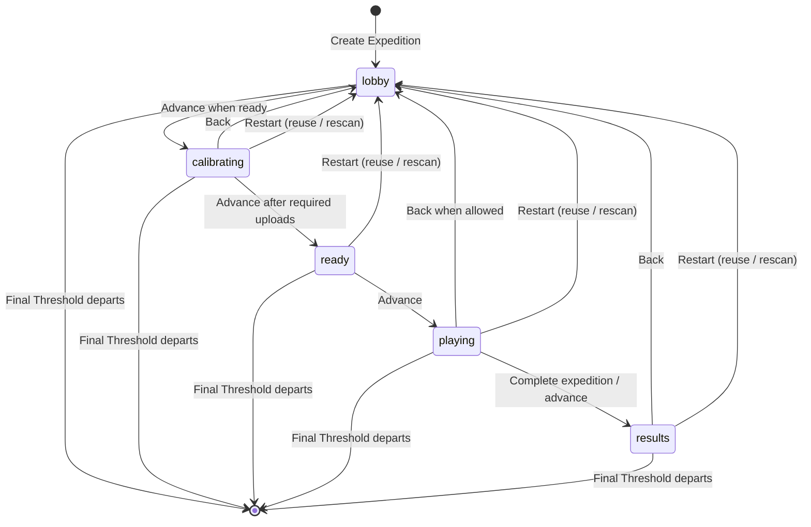

# Threshold — Session Lifecycle

> **Scope:** Session creation, membership, reconnection, phase transitions, return to lobby, restart, and closure for *The Last Witness*.
>
> **Source basis:** October 22, 2026 `main` snapshot (`b9980ee`). This documents server behavior visible in source; cross-device runtime behavior still requires physical-device verification.

## 1. Overview

An **Expedition** is a shared session containing registered Fire TV **Thresholds** and mobile **Lens** players. The Node.js/Express session service maintains membership and authoritative phase metadata. Fire TV and Lens clients use HTTP requests and polling rather than WebSockets.

The service keeps active sessions in a process-local map **and persists session records to SQLite** through `services/session/src/sessionStore.ts`. This is not a multi-instance coordination system; persistence alone does not provide automatic failover or synchronized state across multiple server processes.

## 2. Session model

| Property | Meaning |
|---|---|
| `code` | Four-character Expedition join code |
| `players` | Registered Lens players, each with an ID and display name |
| `thresholds` | Registered Fire TVs with a Threshold ID, device ID, zone, and join timestamp |
| `status` | `awaiting_players` or `ready`, derived from player membership |
| `phase` | `lobby`, `calibrating`, `ready`, `playing`, or `results` |

A session supports up to **four Thresholds**. The target gameplay experience supports **one to six Lens players**; do not assume the server enforces that player maximum without checking the join handler.

Threshold zones are assigned from: **THE NEXUS**, **THE VEIL**, **THE RELIQUARY**, and **THE OBSERVATORY**.

## 3. Session lifecycle at a glance

The diagram summarizes the supported lifecycle; individual transitions are subject to server-side guards. In particular, **Back** and **Restart** have different permissions and data-retention effects.

## 4. Creating and joining

### Create — `POST /sessions`

A Fire TV can create an Expedition with its persistent `deviceId`. The service allocates a code and registers the creating TV. The first assigned zone is **THE NEXUS**. A compatibility path may accept creation without a device ID; new clients should provide one.

### Add Fire TV — `POST /sessions/:code/thresholds`

A TV supplies its device ID. Re-registering an already known device returns its existing registration rather than creating a duplicate. New TVs may join during the **lobby** phase, subject to the four-Threshold maximum. Existing assignments are retained when another TV leaves.

### Add Lens player — `POST /sessions/:code/join`

The Lens supplies a nonempty display name while the Expedition is in the **lobby**. The server creates a player ID **and a player token**, stores a hash of that token, and returns the token to the joining client. A player joining makes the session `ready` when at least one player is present.

**Security distinction:** A join code is a discovery mechanism, not strong authentication. The player token is used to verify reconnection; the TV's device ID should not be treated as a cryptographically authenticated device identity.

## 5. Reconnection

### Fire TV — `POST /sessions/:code/thresholds/reconnect`

A returning TV supplies its persistent device ID. If its registration still exists, the service returns the original Threshold identity, zone, and session without registering a second TV. If the session or registration no longer exists, the server returns a not-found error. The Fire TV client has local session restoration behavior; recovery after an app kill or network interruption should be verified on actual hardware.

### Lens — `POST /sessions/:code/reconnect`

The Lens supplies **both `playerId` and `playerToken`**. The server checks membership and verifies the credential; a missing or incorrect token results in `401 invalid_player_credentials`. A valid request returns the existing player and session state without adding a duplicate player. Browser-side token storage and restoration are separate client concerns.

## 6. Shared phase transitions

**Endpoint:** `POST /sessions/:code/advance`

Only a **registered Fire TV device ID** can request an advance. The backend checks the current phase and applies the configured `PHASE_TRANSITIONS` map, then persists the new session phase.

- **Lobby → calibration:** Requires the session to be `ready` (at least one registered player).
- **Calibration → ready:** Requires at least one uploaded calibration image for **each registered Threshold**. Scan groups in `uploaded`, `analyzing`, `completed`, or `failed` status can satisfy this gate if they contain an image. **AI analysis completion is not required** to advance.
- **Ready → playing:** Initializes the *Last Witness* game state and opening missions.
- **Playing → results:** Progression is governed by the shared phase transition handler; the gameplay completion path must be tested against the active witness/field flow.
- **Results:** No further normal advance; the service returns a conflict for an already completed Expedition.

This phase contract is server-managed. Individual Lens and Fire TV presentation states may still lag until their next poll.

## 7. Return to lobby versus new Expedition

These operations are deliberately different.

| Operation | Endpoint | Effect |
|---|---|---|
| **Back to lobby** | `POST /sessions/:code/back` | Changes the session phase to `lobby`; preserves code and registrations. Does **not** itself guarantee a fresh mystery or cleared calibration data. |
| **Restart, reuse** | `POST /sessions/:code/restart` with `mode: "reuse"` | Returns to lobby, preserves players/TVs/code and existing calibration images, resets scan-group state for reuse, and deletes the previous game state. |
| **Restart, rescan** | Same endpoint with `mode: "rescan"` | Returns to lobby, preserves players/TVs/code, removes stored calibration images and scan groups, and deletes the previous game state. |

Both operations require a registered TV's `deviceId`.

**Back** is accepted during calibration and results, and during gameplay when the witness is complete **or** the caller explicitly requests `endActiveExpedition: true`. It is not a general unrestricted phase-reset endpoint.

**Restart** rejects an unknown mode and a session already in the lobby. The `rescan` path attempts to remove physical images before deleting their database records; a cleanup failure returns an error rather than silently claiming success.

The **new Expedition** wording in the UI should be distinguished from creating a completely new session code: this restart endpoint **reuses the existing Expedition code and registrations**.

## 8. Leaving and closure

### Remove player — `DELETE /sessions/:code/players/:playerId`

Removes a Lens player and recalculates session status. Other players and Thresholds remain in the Expedition. Credential cleanup and any authorization requirements should be checked against the route before claiming strong leave-request authentication.

### Remove TV — `DELETE /sessions/:code/thresholds/:deviceId`

Removes that Threshold registration. If other TVs remain, the Expedition remains open and their zones stay unchanged. If the **last TV leaves**, the service removes the session from active memory and persistent storage and closes the Expedition. Closure is distinct from reaching the `results` phase.

## 9. Failure and recovery boundaries

| Scenario | Server behavior / caveat |
|---|---|
| Unknown Expedition | `404 session_not_found` |
| Unknown TV on reconnect | `404 threshold_not_found` |
| Unknown Lens player on reconnect | `404 player_not_found` |
| Invalid Lens reconnection token | `401 invalid_player_credentials` |
| Unregistered TV tries to advance, go back, or restart | `403 threshold_not_registered` |
| Advance before lobby is ready | `409 expedition_not_ready` |
| Advance without a required Threshold scan | `409 calibration_incomplete` |
| Late join / TV limit / invalid phase | Conflict response according to route |
| Temporary network loss | Client polling/retry and restoration need device-level validation |
| Process restart | SQLite records provide a persistence mechanism; verify startup loading and active-game recovery rather than assuming uninterrupted gameplay |
| Multiple server instances | No demonstrated cross-instance session synchronization |

## 10. Persistence and trust boundaries

SQLite stores sessions and related game/scan data in the server-side storage module. Calibration image bytes may be stored locally or in private S3 depending on configuration. The session service coordinates gameplay facts; AI-generated narrative does **not** supersede server-maintained phase, membership, evidence, or outcome state.

Player credentials, session join codes, and device IDs serve different purposes. Public release should include an explicit review of route authorization, image retention, CORS policy, and abuse controls.

## 11. Validation checklist

- [ ] Create an Expedition on Fire TV; confirm code and initial zone.
- [ ] Join a Lens; confirm `ready` status and player-token issuance.
- [ ] Add second TV; verify distinct zone and synchronized session membership.
- [ ] Reconnect the same TV; verify no duplicate registration.
- [ ] Reconnect Lens with valid token; verify identity restoration.
- [ ] Reject Lens reconnection with incorrect token.
- [ ] Reject phase advance before a player joins.
- [ ] Verify each TV's calibration image requirement; confirm AI analysis can remain pending.
- [ ] Complete solo and multiplayer phase progression through results.
- [ ] Return from calibration/results to lobby using **Back**.
- [ ] Test `reuse` and `rescan` restarts, including image retention/deletion.
- [ ] Remove one of multiple TVs, then the last TV; confirm closure semantics.
- [ ] Restart backend and verify session/game recovery from SQLite.
- [ ] Test transient disconnection on physical Fire TVs and Lenses.

Do not mark these complete solely because a matching route or automated test exists.

## 12. Related documentation

- [System architecture](architecture.md)
- [Game design](game-design.md)
- [Gameplay flow diagram](diagrams/threshold-gameplay-flow.mmd)
- [Game systems diagram](diagrams/threshold-game-architecture.mmd)
- [Developer friction logs](friction-logs/README.md)

**Primary implementation references:** `services/session/src/routes/sessionRoutes.ts`, `services/session/src/sessionStore.ts`, and the Fire TV/Lens session clients.
